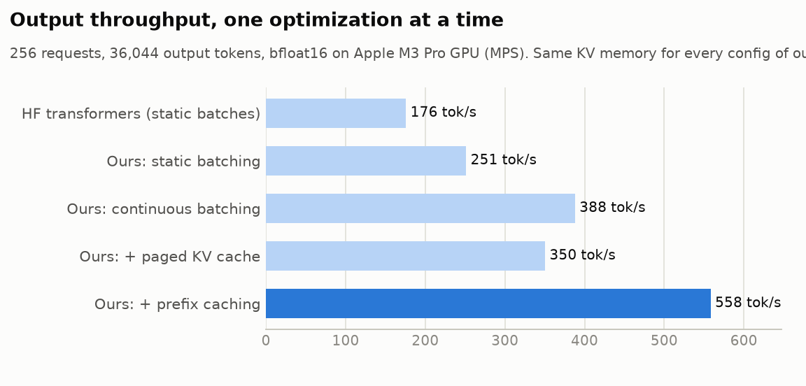
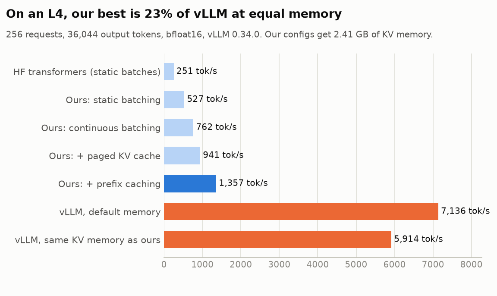
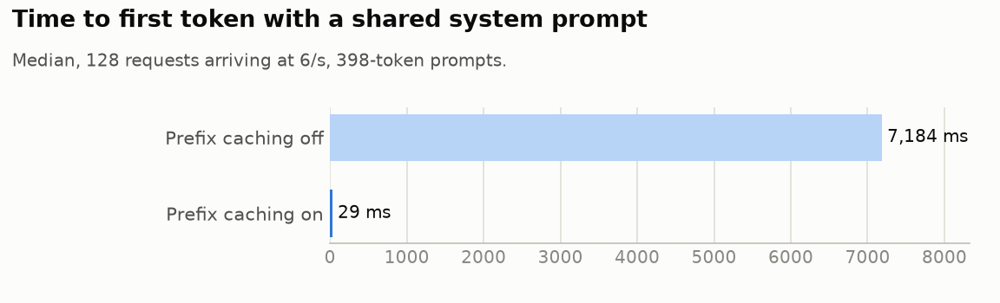

# LLM Serving Engine

An LLM inference engine written from scratch in PyTorch: the system that serves a language model
to many users at once. It runs Qwen3-0.6B with continuous batching, a paged KV cache with
preemption, and prefix caching, behind an OpenAI-compatible streaming API. A live dashboard shows
what the engine is doing.

**[▶ Try the live engine](https://devt-code--llm-serving-engine.us-east.modal.run)** on a cloud CPU, or
**[watch a recorded run](https://devt-code.github.io/llm-serving-engine/)** in the dashboard. The live
engine sleeps while nobody is using it, so its first load can take up to a minute.

- **3.2× the throughput of Hugging Face `generate()`** on an Apple M3 Pro, same model and
  workload (558 vs 176 tok/s), and **median time to first token cut from 80 s to 2.9 s** under
  load compared with static batching.
- **On an NVIDIA L4: 1,357 tok/s, 5.4× Hugging Face and 23% of vLLM's throughput** with the
  same KV memory (19% of vLLM at its default memory settings). [Details](#against-vllm-on-an-nvidia-gpu).
- **2.6× more requests running at once in the same GPU memory**, thanks to the paged KV cache.
- **Median time to first token drops from 7.2 s to 29 ms** at 6 requests per second when requests share a
  system prompt, thanks to prefix caching (96% of prompt tokens reused).
- **Outputs identical to Hugging Face** token for token (fp32 greedy, 20 prompts), and identical
  whether a request runs alone, in a batch, or gets preempted and recomputed: 110 tests.

Every number here is measured and reproducible with the scripts in [`bench/`](bench/). Raw results are in
[`bench/results/`](bench/results/).

## Results

On an Apple M3 Pro GPU (MPS), bf16, Qwen3-0.6B, except the vLLM comparison, which needs an
NVIDIA GPU: see [Against vLLM on an NVIDIA GPU](#against-vllm-on-an-nvidia-gpu).

### One optimization at a time

256 requests arriving at once: half are chats with a ~400-token system prompt, half are short
questions. Outputs are 16–256 tokens (36,044 in total, EOS ignored, so every configuration generates the
same tokens). Our configurations all get the same 2.4 GB of KV memory.

<picture>
  <source media="(prefers-color-scheme: dark)" srcset="docs/ladder-throughput-dark.png">
  
</picture>

| Configuration | Throughput | Median TTFT | Median latency | Peak running |
|---|---:|---:|---:|---:|
| Hugging Face `generate()`, static batches of 32 | 176 tok/s | — | 130.5 s | 32 |
| Ours: static batching | 251 tok/s | 79.9 s | 82.7 s | 32 |
| Ours: continuous batching | 388 tok/s | 40.2 s | 50.2 s | 32 |
| Ours: + paged KV cache | 350 tok/s | 43.0 s | 64.8 s | 94 |
| Ours: + prefix caching | **558 tok/s** | **2.9 s** | **47.1 s** | 256 |

Paged attention on its own is ~10% *slower* than continuous batching on this mixed-length workload.
It runs ~3× more requests at once, but pays for it with 48 preemptions and with gathering every
request's blocks in plain PyTorch (vLLM fuses that gather into a custom kernel). The memory it frees
is what lets prefix caching keep 256 requests in flight. On a workload of short prompts, paging alone
is a clear win; see below.

### Against vLLM on an NVIDIA GPU

The same ladder on an NVIDIA L4 (Colab), bf16, with both engines on PyTorch 2.14, plus vLLM 0.34
run twice: once with the KV memory it sizes for itself, once capped at our engine's 2.41 GB.

<picture>
  <source media="(prefers-color-scheme: dark)" srcset="docs/gpu-vs-vllm-dark.png">
  
</picture>

| Configuration | Throughput | Median TTFT | Peak running |
|---|---:|---:|---:|
| Hugging Face `generate()`, static batches of 32 | 251 tok/s | — | 32 |
| Ours: static batching | 527 tok/s | 34.4 s | 32 |
| Ours: continuous batching | 762 tok/s | 19.0 s | 32 |
| Ours: + paged KV cache | 941 tok/s | 14.0 s | 94 |
| Ours: + prefix caching | **1,357 tok/s** | **0.40 s** | 256 |
| vLLM, same KV memory as ours (19,590 tokens) | 5,914 tok/s | — | — |
| vLLM, default memory (75,495 tokens) | 7,136 tok/s | — | — |

Our best configuration is **5.4× Hugging Face and 23% of vLLM** at equal KV memory. vLLM's lead
comes from what this engine leaves out on purpose: CUDA graphs and `torch.compile` instead of eager
PyTorch (about 1,500 kernel launches per decode step, counted in the dev logs), fused attention kernels that read KV
blocks in place instead of gathering them into padded tensors, and chunked prefill, which mixes new
prompts into decode steps. vLLM ran offline (`LLM.generate`), so its time to first token isn't
measured.

Paging behaves differently on CUDA. On the L4 it is a clear win on its own (762 → 941 tok/s):
running 94 requests instead of 32 outweighs the cost of gathering blocks, which on Apple's GPU made
paging 10% slower. Raw numbers: [`bench/results/ladder_gpu.json`](bench/results/ladder_gpu.json).

### Paged KV cache: more requests in the same memory

256 requests, short prompts, mixed output lengths, the same KV memory for both caches (paged runs allow up
to 256 requests at once).

<picture>
  <source media="(prefers-color-scheme: dark)" srcset="docs/paged-concurrency-dark.png">
  
</picture>

| KV memory | Cache | Mean running | Throughput | Median TTFT |
|---|---|---:|---:|---:|
| 1.17 GB | one fixed slot per request | 28 | 632 tok/s | 23.6 s |
| 1.17 GB | **paged, 16-token blocks** | **73** | **758 tok/s** | **1.8 s** |
| 2.35 GB | one fixed slot per request | 50 | 827 tok/s | 14.4 s |
| 2.35 GB | **paged, 16-token blocks** | **112** | **963 tok/s** | **1.8 s** |

### Prefix caching: a shared system prompt is computed once

128 requests with the same 380-token system prompt and different questions, arriving at 6 per second.

<picture>
  <source media="(prefers-color-scheme: dark)" srcset="docs/prefix-ttft-dark.png">
  
</picture>

Without caching the engine can't keep up with 6 requests per second, so a queue builds. With it, each new request only
computes its own question: prefill work drops 27× (52,809 → 1,944 tokens).

## How it works

```
   HTTP clients (OpenAI SDK, Open WebUI, curl)        Dashboard (React)
          │  /v1/chat/completions, SSE streaming           ▲  WebSocket /v1/events
          ▼                                                │
   ┌────────────── server/ (FastAPI) ───────────────┐      │
   │  async handlers  ⇄  queue  ⇄  engine thread    │──────┘
   └────────────────────────┬───────────────────────┘
                            ▼
   ┌──────────────────── engine/ ───────────────────────────────────────┐
   │  Scheduler: who runs this step? admit · preempt · free            │
   │      │                                                             │
   │      ▼                                                             │
   │  Block manager: 16-token blocks, block tables, refcounts,          │
   │                 prefix hash table, LRU of cached blocks            │
   │      │                                                             │
   │      ▼                                                             │
   │  Model runner: Qwen3 in PyTorch (RMSNorm, RoPE, GQA + q/k norm,    │
   │                SwiGLU), attention reads K/V through block tables   │
   │      │                                                             │
   │      ▼                                                             │
   │  Sampler: greedy, temperature, top-p (per-request seeded RNG)      │
   └────────────────────────────────────────────────────────────────────┘
```

Each `step()` is one forward pass: either a **prefill**, which processes the prompts of newly admitted
requests, or a **decode**, which produces one token for every running request.

- **Continuous batching** ([`engine/scheduler.py`](engine/scheduler.py)). The batch is rebuilt every
  step, so finished requests leave immediately and waiting requests join as soon as there's room.
  The forward pass has no batch dimension: requests are concatenated into one flat token list, the
  way vLLM lays them out.
- **Paged KV cache** ([`engine/kv_cache.py`](engine/kv_cache.py)). KV memory is a pool of 16-token
  blocks. Each request has a block table (logical block → physical block), and blocks are handed out
  only as a request grows. When the pool runs dry, the newest request is **preempted**: its blocks are freed and it is
  recomputed later. Outputs don't change.
- **Prefix caching**. A full block's key is a chained hash of its tokens and everything before them.
  New requests reuse the longest cached prefix (reference counted), and finished requests' blocks
  stay cached until memory is needed, evicted least recently used first.
- **One attention layout** for fresh prompts, cached prefixes, and decode: queries in a padded
  `[requests, new tokens]` grid, keys gathered from each request's blocks. Decode batches with very
  different context lengths are attended in length-sorted groups to cut padding.
- **Server** ([`server/`](server/)). The engine runs on its own thread; asyncio handlers talk to it
  through queues. Responses stream as server-sent events, a client that disconnects is aborted
  and its memory freed, and stop strings and usage are reported the way OpenAI does.

The [dev logs](devlog/) walk through every stage, with the numbers, the bugs and the profiling
(one indexing call was 4× slower than another for the same copy on Apple GPUs).

## Run it

Requires Python 3.11 and about 4 GB of disk (PyTorch plus the 1.5 GB model). Works on Apple Silicon (MPS), NVIDIA (CUDA), or CPU.

```bash
git clone https://github.com/devt-code/llm-serving-engine.git && cd llm-serving-engine
python3.11 -m venv .venv && source .venv/bin/activate
pip install -r requirements.txt
python -c "from huggingface_hub import snapshot_download; snapshot_download('Qwen/Qwen3-0.6B', local_dir='models/qwen3-0.6b')"
```

**Start the server** (OpenAI-compatible, on http://localhost:8000/v1):

```bash
python -m server.api
```

```python
from openai import OpenAI
client = OpenAI(base_url="http://localhost:8000/v1", api_key="unused")
for chunk in client.chat.completions.create(
    model="qwen3-0.6b", messages=[{"role": "user", "content": "Explain a KV cache."}], stream=True
):
    print(chunk.choices[0].delta.content or "", end="")
```

**Open the dashboard** (needs Node 18+), then choose **Live engine**:

```bash
cd dashboard && npm install && npx vite      # http://localhost:5173
```

Click **Send 50 requests** or drag the arrival-rate slider, and watch requests join the batch,
blocks fill up, prefix blocks get shared, and requests get preempted when memory runs out. Or
type a prompt under **Ask the model**: the reply streams in while your request runs in the same
batch, marked *you* in the request timeline.

**Use it as a library:**

```python
from engine.engine import LLMEngine
from engine.loader import load_model
from engine.request import SamplingParams

engine = LLMEngine(load_model(), kv_cache_gb=2.0)
outputs = engine.generate([[9707, 11, 1879]], SamplingParams(max_new_tokens=32))
```

## Deploy it

The [`Dockerfile`](Dockerfile) packs the server, the model and the dashboard into one CPU image
that runs on any Docker host:

```bash
docker build -t llm-serving-engine . && docker run --rm -p 7860:7860 llm-serving-engine   # http://localhost:7860
```

The live demo runs the same server on [Modal](https://modal.com) ([`deploy/modal/app.py`](deploy/modal/app.py)),
which starts it on the first request and stops it a minute after the last. Without a payment
method on file, Modal's free plan includes $1 of compute a month (about 7 hours of serving on
CPU) and stops the app once that is used up, so it can't charge anything:

```bash
pip install modal && modal token new
deploy/modal/deploy.sh      # builds the dashboard, deploys, prints the URL
```

On a public server, `--max-tokens-cap`, `--max-waiting` and `--demo-max-count` keep one visitor
from tying up the machine, and `--ws-idle-timeout` disconnects idle dashboards so the server can
shut down.

## Tests

```bash
pytest
```

110 tests (about 3 minutes on a laptop). They:

- compare every model component with Hugging Face, using the real weights;
- check greedy generation on 20 prompts;
- check that batching, preemption, prefix caching and every block size leave outputs unchanged;
- run the block manager's bookkeeping with no leaked blocks;
- drive the server with the official `openai` client.

Two CUDA tests run on NVIDIA GPUs only; both pass on an L4.

## Benchmarks

| Script | What it measures |
|---|---|
| `bench/ladder.py` | The comparison ladder above (`--only vllm` and `--only vllm_kv` on an NVIDIA GPU) |
| `bench/batching.py` | Static vs continuous batching |
| `bench/paged.py` | Slot vs paged cache at equal memory, concurrency sweep |
| `bench/prefix.py` | Shared-system-prompt workload, burst and Poisson arrivals |
| `bench/hf_baseline.py`, `bench/engine_single.py` | Single-request baselines |
| `bench/record_demo.py` | Records the dashboard's replay traces |
| `bench/make_charts.py` | Renders the charts in this README |

### Benchmark against vLLM

[`notebooks/benchmark_vs_vllm.ipynb`](notebooks/benchmark_vs_vllm.ipynb) runs the whole ladder
plus both vLLM runs on one NVIDIA GPU (Colab or Kaggle) and the two CUDA tests. The L4 numbers
above came from it, in under half an hour.

## Project layout

```
engine/      model.py (Qwen3), scheduler.py, kv_cache.py (paged + prefix cache), batch_cache.py,
             engine.py (step loop), sampler.py, events.py (event stream), loader.py
server/      api.py (FastAPI, OpenAI-compatible), async_engine.py (engine thread)
dashboard/   React + TypeScript + Vite + Recharts; replay traces in public/traces/
deploy/      the Modal app behind the live demo (the Dockerfile is at the root)
bench/       benchmarks and results/
tests/       pytest suite
notebooks/   NVIDIA GPU checks and the vLLM comparison
devlog/      build notes, results and profiling for each stage
```

## Limits

This engine is for learning and measurement, not production: one GPU, one model family, and attention
written in plain PyTorch (no custom kernels, no CUDA graphs), which is why it reaches about a quarter
of vLLM's throughput on the same GPU. Very high concurrency on a
small pool causes preemption thrashing, which the dashboard's memory-pressure recording shows.
